# AWS Lambda + DynamoDB + S3 Backup Project

**Name:** Asif Istiaque
**Region:** US West (Oregon), us-west-2
**Date:** 5 and 6 November 2026

---

## 1. What I made

In this project I made a small system on AWS. It does three simple things.

First, it takes 10 sample users from a public website. Second, it saves them in a database (DynamoDB). Third, every 2 minutes it makes a copy of the database and saves it as a JSON file in S3.

I did everything from the AWS website, and the code is in Python. I did not put any password or key in the code.

Here are the names I used:

- DynamoDB table: `jsonplaceholder-users`
- S3 bucket: `asif-lambda-backups-958710`
- First Lambda (saves users): `import-jsonplaceholder-users`
- Second Lambda (makes the backup): `export-dynamodb-to-s3`
- Schedule: `dynamodb-backup-every-2min`

---

## 2. How it works

The flow is like this:

```text
Public API  ->  Lambda 1  ->  DynamoDB  ->  Lambda 2  ->  S3 bucket
                                              ^
                                       EventBridge Scheduler
                                        (every 2 minutes)
```

Lambda 1 gets the users from the website and puts them in DynamoDB. I run it by hand.

Lambda 2 reads everything from DynamoDB and saves it as a new file in S3. The scheduler runs it for me every 2 minutes, like an alarm clock.

Both Lambdas write their logs to CloudWatch, so I can see what they did.

---

## 3. DynamoDB table and S3 bucket

### The table

I made a table called `jsonplaceholder-users`. The key is `id`, and it is a number. Figure 1 shows the table is active.

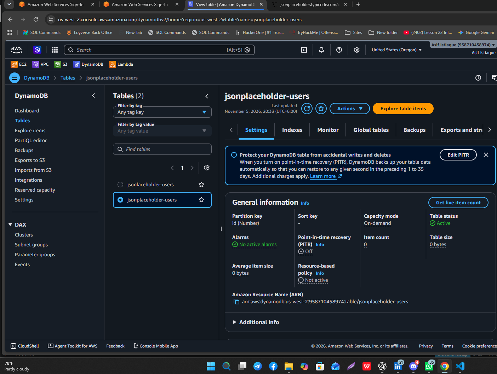

*Figure 1: The new table. The item count is 0 because no data was added yet.*

You can see two tables in the list. The first one had a spelling mistake in the name (`jsonlaceholder-users`, the "p" is missing). My Lambda could not find it and gave a `ResourceNotFoundException` error. I made a new table with the right name. I deleted both tables at the end.

### The bucket

I made a bucket called `asif-lambda-backups-958710` in the same region. I kept the default settings, so it is private.

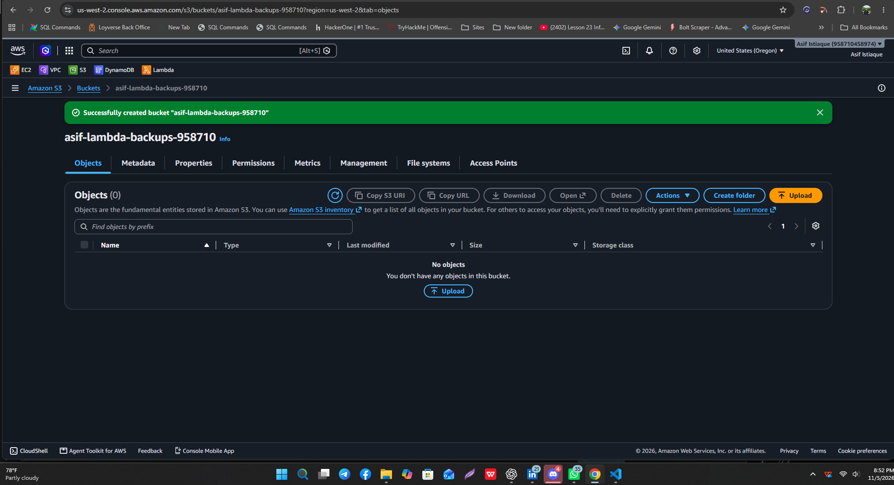

*Figure 2: The new bucket is empty for now.*

---

## 4. Lambda 1: save users in DynamoDB

This function calls the public website, gets 10 users, and saves each one in the table.

A new Lambda is not allowed to use DynamoDB at first. So I gave its role one small permission: it can only add items (`PutItem`) to my table. It cannot do anything else.


*Figure 3: The role of Lambda 1 and the permission I added.*

Then I set the table name in an environment variable and uploaded the code ZIP.

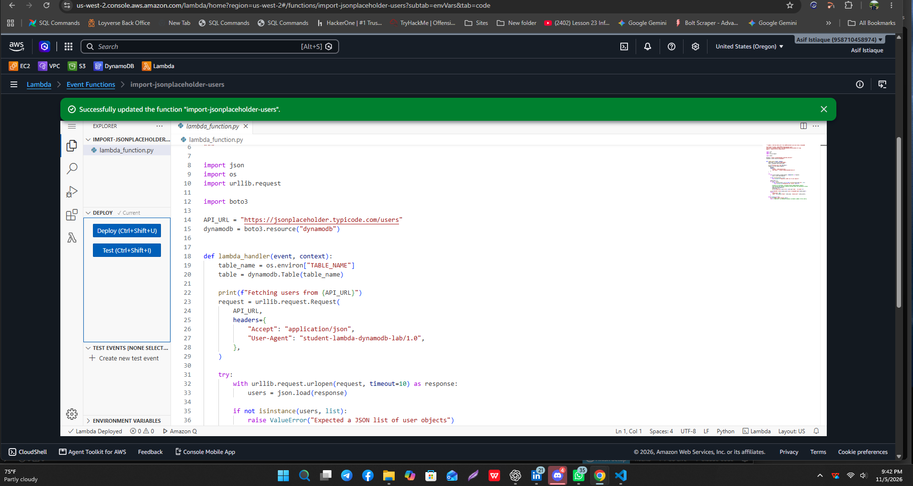

*Figure 4: The code is uploaded and deployed.*

I ran a test, and it worked. The log shows each user being saved.

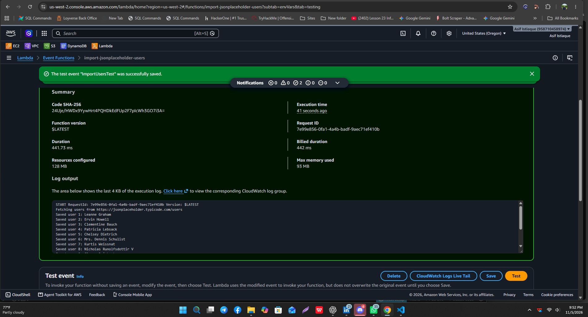

*Figure 5: Test result of Lambda 1.*

The CloudWatch log shows the same thing. It also shows that I ran the function two times.

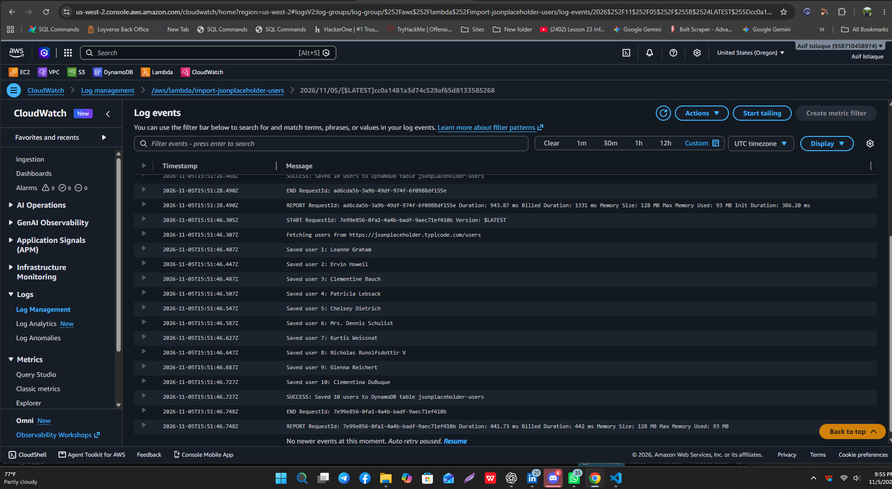

*Figure 6: Both runs saved 10 users.*

After that I opened the table. It has exactly 10 users, even though I ran the function two times.

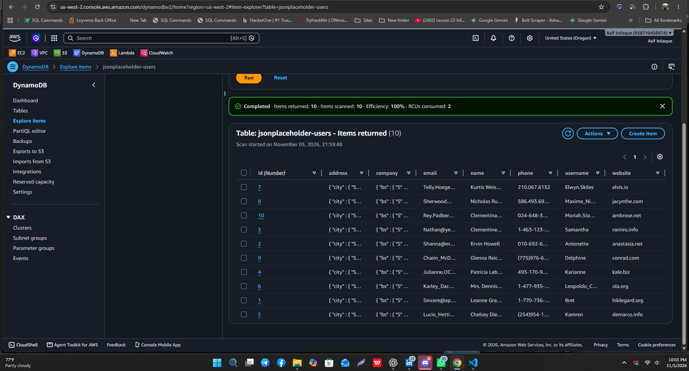

*Figure 7: The table has 10 items.*

---

## 5. Lambda 2: save a backup in S3

This function reads all users from the table and saves them as one JSON file in S3. Every file gets a new name, made from the date, the time and the request ID. So a new run never replaces an old file.

This function needs two permissions: read the table (`Scan`) and write files in my bucket (`PutObject`). It cannot delete anything.


*Figure 8: The role of Lambda 2 and the two permissions I added.*

I set the table name and bucket name as environment variables and uploaded the code.

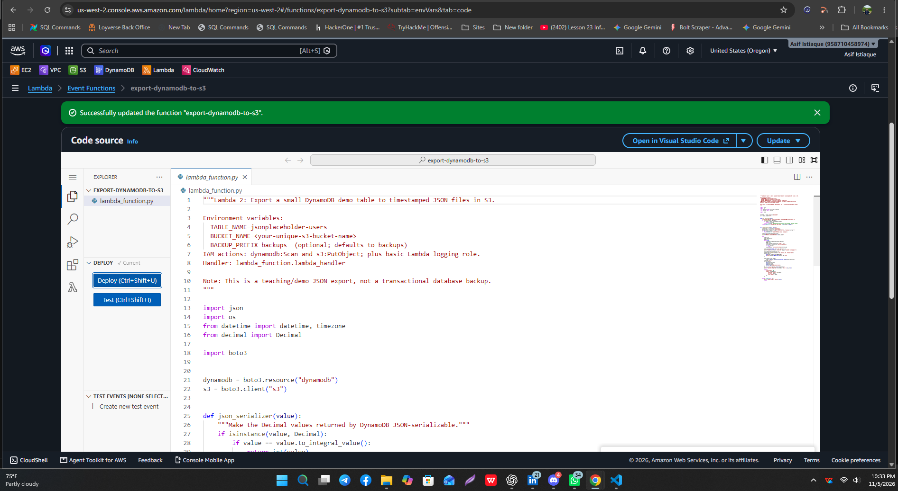

*Figure 9: The code is uploaded and deployed.*

Then I ran a test by hand. It exported 10 users and saved a file in S3.

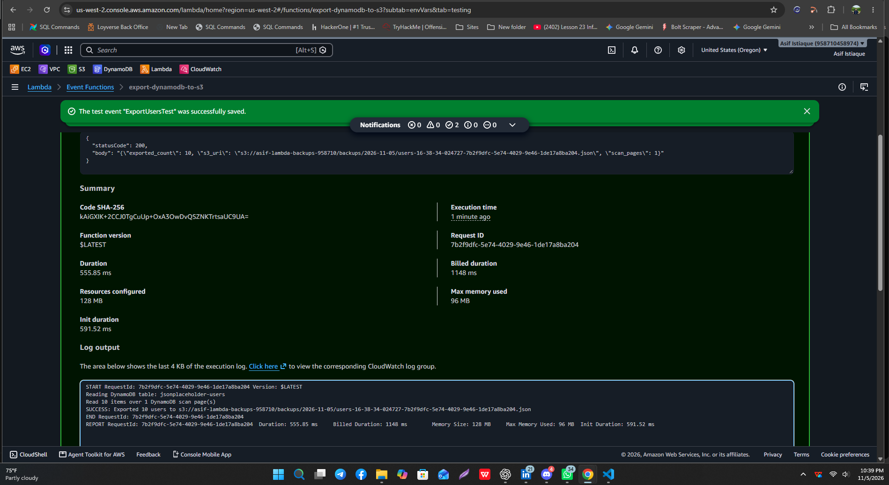

*Figure 10: The result says `exported_count: 10` and shows the file address.*

I also opened one of the files. It is a list of 10 users with their name, email, address and company.


*Figure 11: One backup file opened.*

---

## 6. Running it every 2 minutes

In EventBridge Scheduler I made a schedule that runs Lambda 2 every 2 minutes, using `rate(2 minutes)`.

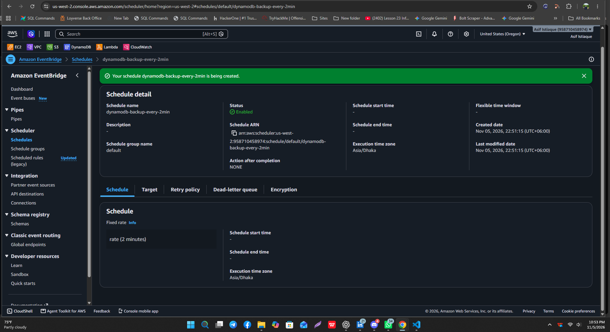

*Figure 12: The schedule is enabled.*

After some minutes I looked at the bucket. There were 6 files. The first one came from my manual test. The other five came from the schedule, and they are 2 minutes apart.

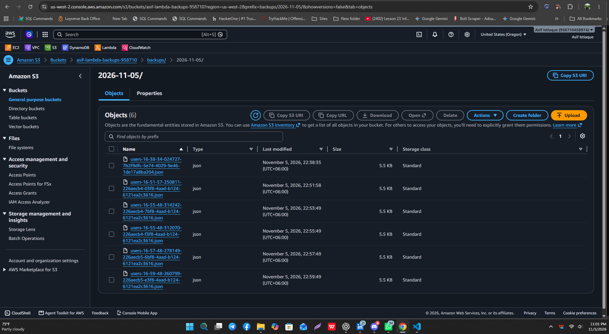

*Figure 13: Six files with six different names.*

The log of Lambda 2 shows the same runs.

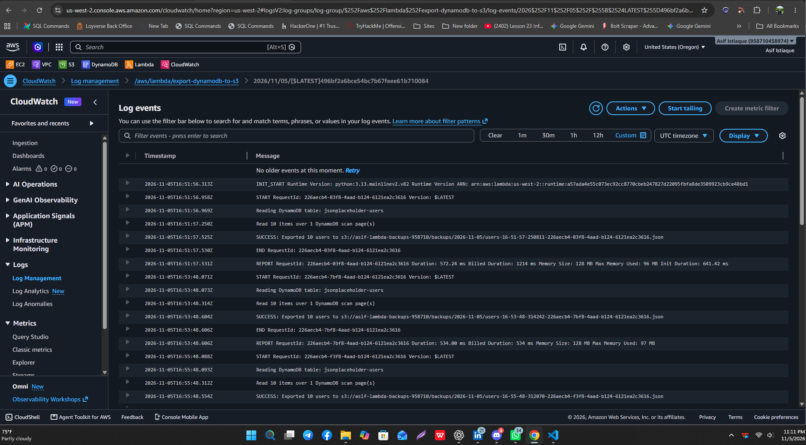

*Figure 14: Each run read 10 items and exported 10 users. The log shows UTC time, so 16:51 here is 22:51 in Bangladesh.*

---

## 7. Logs and metrics

CloudWatch gave me two ways to see what happened.

The logs tell the story of each run. For example, "Saved user 3". The metrics are numbers, like how many times a function ran, how many times it failed, and how long it took.


*Figure 15: Metrics of Lambda 1.*


*Figure 16: Metrics of Lambda 2. The number of runs goes up because of the schedule.*

---

## 8. Clean up

The schedule makes about 720 files in a day, so I did not want to leave it on. After I got my proof, I turned it off and deleted everything.

First I disabled the schedule, then I deleted it.

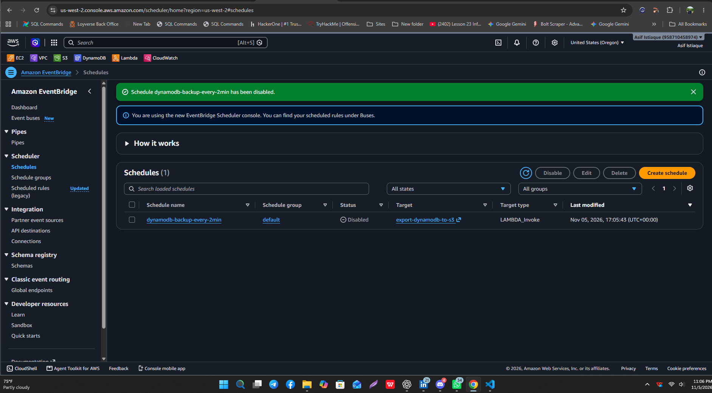

*Figure 17: The schedule is disabled.*

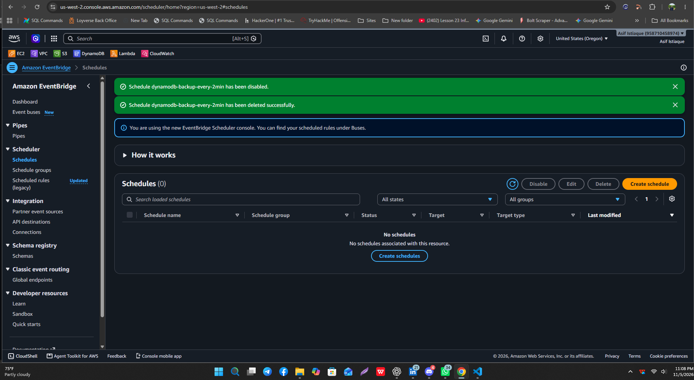

*Figure 18: The schedule is deleted.*

Then I deleted both DynamoDB tables, the right one and the one with the spelling mistake.

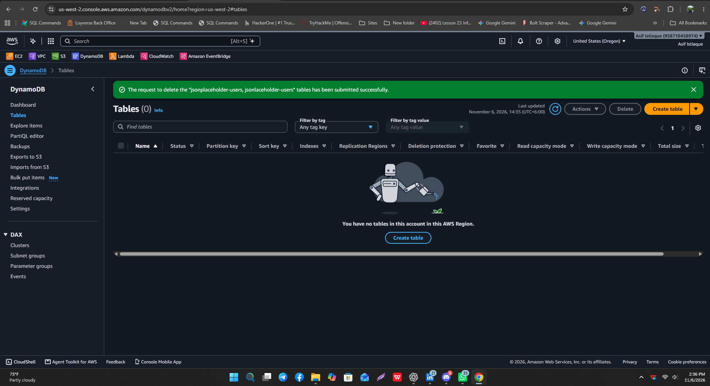

*Figure 19: No tables left.*

Then I deleted the two Lambda functions. The one function left in the list (`fetch-jsonplaceholder-users`) is from my earlier practice. It is not part of this project.

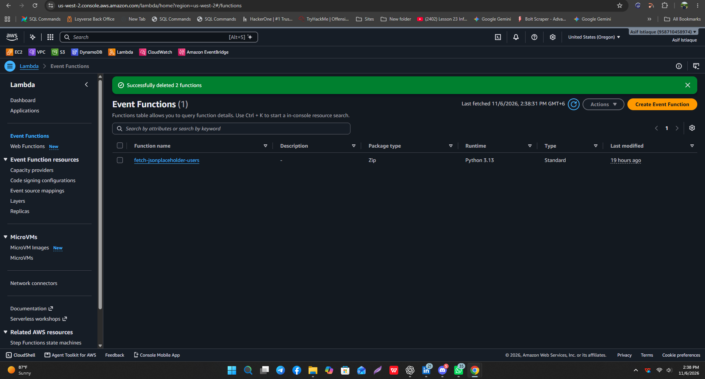

*Figure 20: Both project functions are deleted.*

At the end I emptied the S3 bucket. 9 files were deleted.

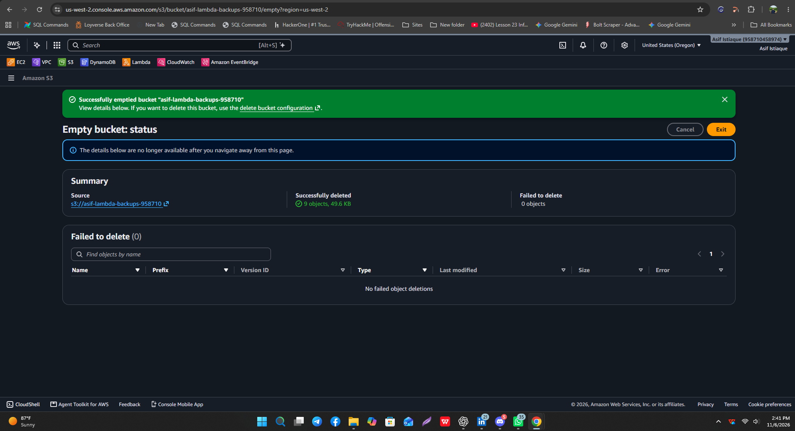

*Figure 21: The bucket is empty.*

---

## 9. Problems I had

My first problem was the wrong table name. I typed `jsonlaceholder-users` and forgot the "p". The Lambda gave an error because it could not find the table with the right name. A table name cannot be changed, so I made a new table.

My second problem was that the item count showed 0 for a new table. This is normal. DynamoDB updates that number only after many hours. To check the data fast, I used **Explore table items**.

---

## 10. Questions and answers

### 1. What is the difference between Lambda's role and Scheduler's role?

Lambda's role decides what my function is allowed to do. For example, Lambda 2 can read the table and write files in S3.

Scheduler's role decides who is allowed to start my function. It only needs the permission to run the Lambda. It does not touch the table or the bucket.

### 2. Why does running Lambda 1 two times not give 20 users?

In DynamoDB every user has an `id`, and an `id` can be in the table only one time. When I save a user with an `id` that already exists, DynamoDB replaces the old one. So user 1 is just replaced with user 1 again. Figure 6 shows two runs, and Figure 7 shows 10 users.

### 3. Why do the backup files have a time and a request ID in the name?

So that no file is replaced. In S3, a new file with the same name would silently replace the old one. With the time and the request ID in the name, every run makes a new file. This also gives me a history, so I can see what the table had at a certain time.

### 4. What is the difference between `print()` logs and Invocations and Errors metrics?

The `print()` logs are the details of one run, like "Saved user 3: Clementine Bauch". I use them to understand what happened.

Metrics are only numbers. Invocations is how many times the function ran. Errors is how many times it failed. I use them to see the big picture. The names of the users are only in the logs, not in the metrics.

### 5. What if I delete the table but keep the JSON files in S3?

I would get my data back, because the files have all the users. I could make a new table and add the users again.

But I would not get the table settings back. The JSON files only have the users. They do not have things like indexes, alarms, capacity settings and permissions. I would have to set those up again by hand.

### 6. Why is a backup every 2 minutes a bad idea for a big production database?

First, it costs a lot. Each backup reads the whole table, and reading costs money. Doing this all day on a big table is very expensive.

Second, it can fail. A big table may take too long, and Lambda has a time limit.

Third, it is not a true snapshot. If the data changes while the function is reading, the file can have a mix of old and new data.

Fourth, it makes too many files. That is about 720 files in one day.

For a real system, AWS has better tools, like Point-in-Time Recovery and the DynamoDB Export to S3 feature. They are made for backups and they do not slow down the table.

---

## 11. Conclusion

The project worked from start to end. The API gave me 10 users, Lambda 1 saved them in DynamoDB, and Lambda 2 copied them to S3, first by hand and then by itself every 2 minutes. At the end I deleted everything, so there are no extra charges.

The most useful thing I learned is that each part of AWS needs its own small permission, and that a simple copy to S3 is good for learning but not a real backup plan.
